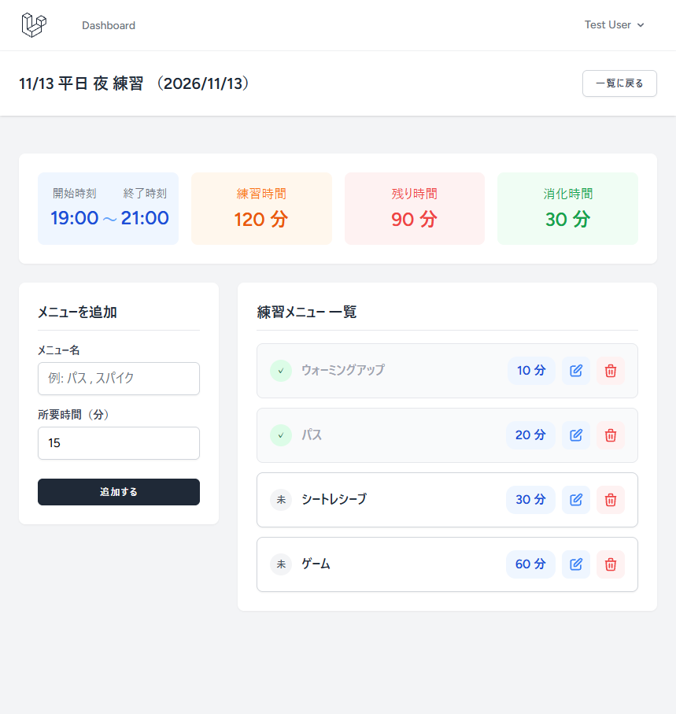
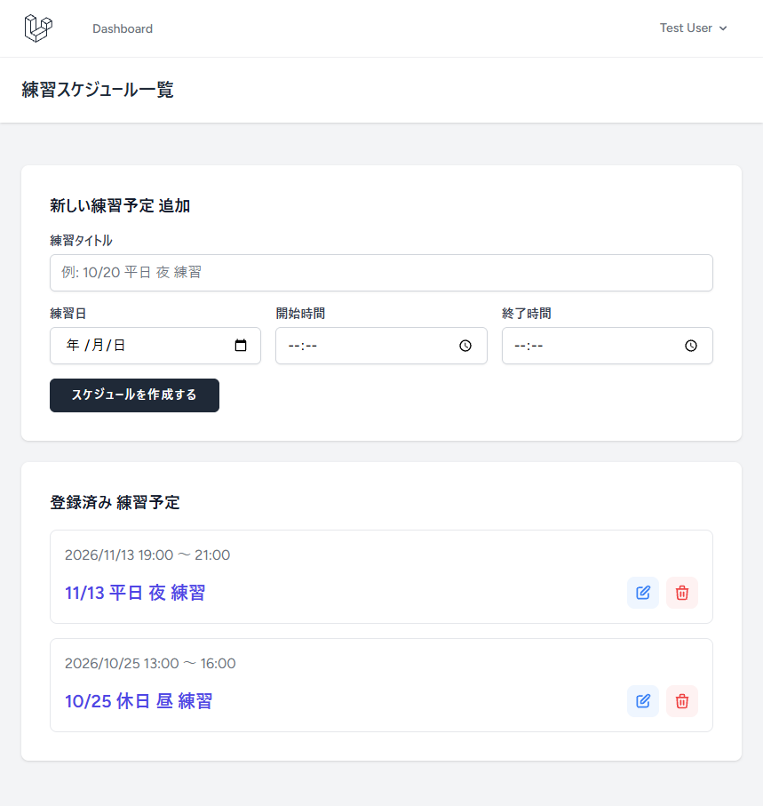

# 練習スケジュール管理アプリ

個人やチームスポーツでの練習スケジュールとメニューを効率的に作成・管理できるWebアプリです。

---

## URL

https://example.com

### テスト用アカウント
- メールアドレス：test@example.com
- パスワード：password

---

## 開発の背景

趣味でバレーボールしている中で、日々の練習メニューや時間配分の作成・管理に煩わしさを感じていました。
そうした手間を解消し、予定と時間を手軽に管理できるようにするために本アプリを開発しました。

---

## 主な機能

- **ユーザー認証**
  - Laravel Breezeを用いた安全なログイン・ユーザー登録機能
  - 自分の作成したスケジュール・メニューのみ閲覧・操作可能（セキュリティ保護）

- **スケジュール管理**
  - 練習日、タイトル、開始時間、終了時間を指定してスケジュールを作成・編集・削除
  - スケジュールの時間枠（総枠時間、残り時間、消化時間）をダッシュボード形式で表示
  


- **練習メニュー管理**
  - スケジュールに紐づく練習メニュー（名前、所要時間）の追加・編集・削除
  - 予定された全体時間を超えないための超過防止バリデーション
  - 完了・未完了のステータス切り替え



- **スムーズな操作性**
  - ドラッグ＆ドロップによる並び替え（Livewire活用）
  - 再入力時に自動で消えるエラー表示（Alpine.js活用）

---

## 使用技術

- **Backend**: PHP 8.5, Laravel 13.x
- **Frontend**: Blade Templates, Livewire 4.x, Alpine.js, Tailwind CSS
- **Database**: MySQL
- **Environment**: Docker (Laravel Sail), Ubuntu (WSL2)
- **Infrastructure / Deployment**: Render
- **Version Control**: Git, GitHub

---

## 工夫した点

1. **スケジュール時間枠の可視化とリアルタイムな状況把握**
   - ダッシュボード上に「総枠時間・残り時間・消化時間」を表示し、ユーザーがスケジュールの時間配分を一目で把握できるようにしました。
2. **非同期通信による直感的な並び替え**
   - Livewireを活用し練習メニューの並び替えをページリロードなしで直感的に操作・保存できるようにし、操作性を向上させました。

---

## 苦労した点

1. **時間枠超過を防ぐバリデーション**
   - **課題:** 練習メニューの合計時間が、スケジュール全体の枠時間を超えて登録できてしまう問題がありました。
   - **解決:** メニューの合計時間をその場で自動計算してチェックする仕組みを作り、時間が飛び出してしまう設定を未然に防ぐようにしました。

2. **エラー発生時の入力保持と分かりやすい表示**
   - **課題:** エラー時にフォームの入力値が消え、修正箇所が分かりにくい状態でした。
   - **解決:** 入力状態の保持と分かりやすいエラー表示に調整し、スムーズに再入力できる画面に改善しました。

---

## データベース設計 (E-R図)

```mermaid
erDiagram
    users ||--o{ schedules : "1 : 多"
    schedules ||--o{ menu_items : "1 : 多"

    users {
        bigint id PK
        string name
        string email UK
        timestamp email_verified_at
        string password
        string remember_token
        timestamps timestamps
    }

    schedules {
        bigint id PK
        bigint user_id FK
        string title
        date date
        time start_time
        time end_time
        timestamps timestamps
    }

    menu_items {
        bigint id PK
        bigint schedule_id FK
        string name
        integer duration_minutes
        boolean is_completed
        integer sort_order
        timestamps timestamps
    }